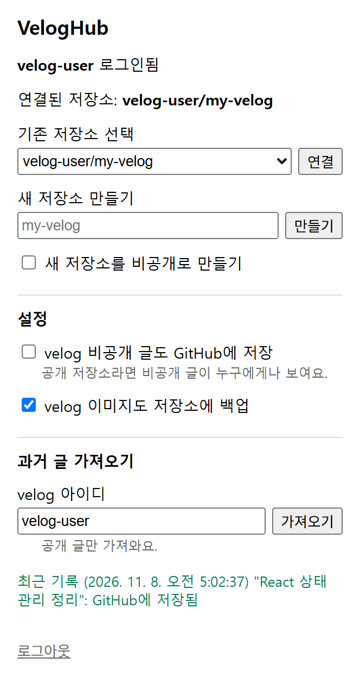

<p align="center"></p>

<h1 align="center">VelogHub</h1>

<p align="center">velog에 글을 출간하는 순간, GitHub 저장소에 자동으로 커밋해 주는 크롬 확장 프로그램</p>

백준허브가 알고리즘 풀이를 GitHub에 올려 주듯, VelogHub는 블로그 글을 GitHub에 올려 줍니다.
블로그 활동이 GitHub 잔디로 이어지고, 직접 쓴 원본 마크다운이 내 저장소에 그대로 남습니다.

## 기능

- **출간 즉시 커밋**: "출간하기"를 누르면 바로 커밋됩니다. 임시저장은 커밋하지 않습니다.
- **원본 마크다운 그대로**: HTML로 바뀐 글이 아니라 직접 쓴 마크다운에 제목·날짜·태그·시리즈·주소를 붙여 저장합니다.
- **수정·삭제 반영**: 글을 고치면 같은 파일을 업데이트하고, velog에서 지우면 저장소에서도 지웁니다.
- **이미지 백업**: 글 속 velog 이미지를 저장소에 함께 저장하고 링크를 저장소 경로로 바꿉니다.
- **시리즈별 폴더**: 시리즈에 속한 글은 `posts/시리즈명/`에 정리됩니다.
- **과거 글 가져오기**: 지금까지 쓴 공개 글을 커밋 한 번으로 가져옵니다.
- **비공개 글 선택**: 비공개 글은 기본으로 저장하지 않고, 설정에서 켤 수 있습니다.

<p align="center"></p>

## 설치

크롬 웹스토어 등록 전이라 지금은 직접 불러와야 합니다.

1. 이 저장소를 내려받습니다. (`Code` → `Download ZIP` 후 압축 풀기, 또는 `git clone`)
2. 크롬에서 `chrome://extensions`를 열고 오른쪽 위 **개발자 모드**를 켭니다.
3. **압축해제된 확장 프로그램 로드**를 누르고 내려받은 폴더를 고릅니다.

## 사용법

1. 툴바의 VelogHub 아이콘을 누르고 **GitHub로 로그인**을 누릅니다.
2. 화면에 나온 코드를 GitHub 페이지에 입력하고 승인합니다.
3. 글을 저장할 저장소를 고르거나 새로 만듭니다. (예: `my-velog`)
4. velog에서 평소처럼 글을 출간하면 오른쪽 아래에 "GitHub에 저장됨" 알림이 뜹니다.

이미 쓴 글이 있다면 팝업의 **과거 글 가져오기**에 velog 아이디를 넣고 **가져오기**를 누르세요.

## 저장소에 저장되는 모습

```
my-velog/
└── posts/
    ├── 2026-11-07-글주소.md
    ├── 리액트 공부/
    │   └── 2026-10-01-useState-정리.md
    └── images/
        └── 2026-11-07-글주소/
            └── 1.png
```

```markdown
---
title: "useState 정리"
date: 2026-10-01
tags: ["React","상태관리"]
series: "리액트 공부"
velog_url: https://velog.io/@아이디/useState-정리
---

본문...
```

- 파일 이름은 `출간일-velog 글 주소.md`입니다. 글 주소는 계정 안에서 겹치지 않아 같은 제목의 글도 따로 저장됩니다.
- 커밋 메시지는 `[velog] 제목`, 수정은 `[velog] 제목 수정`, 삭제는 `[velog] 삭제: 파일이름`입니다.

## 알아둘 점

- **공개 저장소에 저장하면 누구나 글을 볼 수 있습니다.** 비공개 글까지 저장하려면 비공개 저장소를 쓰세요. 비공개로 바꾸거나 지운 글도 git 기록에는 남습니다.
- **과거 글 가져오기는 공개 글만** 가져옵니다.
- velog API는 공식 공개 API가 아니어서 velog가 바뀌면 동작하지 않을 수 있습니다. 저장에 실패하면 velog 화면과 팝업의 "최근 기록"에 이유가 표시됩니다.
- GitHub 토큰은 이 브라우저의 확장 저장소(`chrome.storage`)에만 보관되고, GitHub 외의 서버로 보내지 않습니다. 로그아웃해도 GitHub 쪽 권한은 남으므로, 완전히 끊으려면 GitHub → Settings → Applications에서 VelogHub 권한을 지우세요.
- 확장을 새로고침했다면 열려 있던 velog 탭도 새로고침해야 합니다.

## 개발

1. GitHub OAuth App을 만듭니다: GitHub → Settings → Developer settings → OAuth Apps → New OAuth App
   - Homepage URL, Callback URL은 아무 주소나 넣어도 됩니다. (Device Flow에서는 쓰지 않음)
   - **Enable Device Flow**는 켜고, **Expire user access tokens**는 끕니다. (토큰을 새로 받으려면 비밀키가 필요해서)
2. 받은 Client ID를 `src/config.js`의 `CLIENT_ID`에 넣습니다.
3. 위 [설치](#설치) 방법으로 불러옵니다.

```
manifest.json      확장 설정 (Manifest V3)
src/background.js  서비스 워커: 로그인, 저장소 연결, 글 커밋·삭제, 과거 글 가져오기
src/github.js      GitHub 인증(Device Flow)과 API, 여러 파일을 커밋 하나로 묶기
src/velog-hook.js  velog 페이지에서 출간·수정·삭제 요청을 가로챔 (velog 요청 형식은 여기에)
src/content.js     velog-hook.js의 소식을 백그라운드로 넘기고 알림 표시
src/markdown.js    front matter를 붙인 마크다운, 파일·이미지 경로 만들기
src/velog.js       과거 글 전체 불러오기 (velog GraphQL)
src/config.js      OAuth Client ID
popup/             확장 팝업 화면
icons/             아이콘 (icon.svg가 원본)
```

테스트는 `npm test`로 실행합니다. (Node 20 이상, 설치할 패키지 없음)
